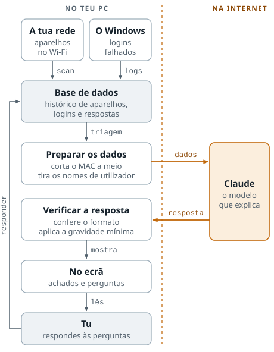
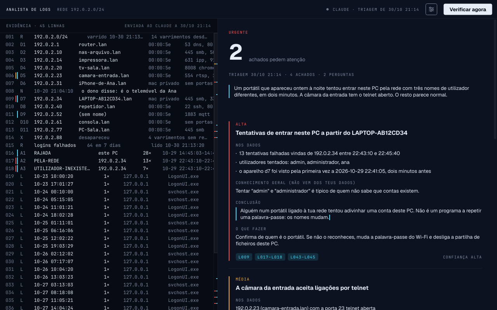

# Analista de logs com LLM

[](https://github.com/tomazio177/Analista-de-logs-com-LLM/actions/workflows/testes.yml)

Vigia a rede de casa e o PC: descobre que aparelhos estão ligados e que portas têm abertas, lê as palavras-passe erradas registadas no Windows, guarda o histórico e pede a um LLM que explique, em português simples, o que merece atenção.

O scanner, a descoberta de aparelhos, os logs e a base de dados usam só módulos do próprio Node. As únicas dependências são as da triagem: o SDK da Anthropic e o Zod.

> **Só contra redes tuas.** Varrer redes alheias sem autorização é crime (em Portugal, Lei do Cibercrime, Lei 109/2009). Este projeto existe para conhecer e proteger a rede de casa.

## O caminho da informação

<picture>
  <source media="(prefers-color-scheme: dark)" srcset="docs/mapa-escuro.svg">
  
</picture>

Tudo corre no PC, menos uma parte: o Claude. Os dados só saem para a internet nesse ponto, e já saem preparados (metade do MAC, sem os nomes de utilizador do PC). As respostas do dono voltam para a base de dados e entram na triagem seguinte.

## Descarregar

A app para Windows (com instalador) está nas [Releases](https://github.com/tomazio177/Analista-de-logs-com-LLM/releases). O instalador não tem assinatura digital, por isso o Windows mostra o aviso do SmartScreen: **Mais informações → Executar mesmo assim**.

## Como correr

```bash
npm run vigiar   # tudo de seguida: varre a rede, lê os logins falhados e pede a triagem
npm run scan     # ou só o varrimento
```

Precisa de Node 22.13 ou mais recente. O primeiro varrimento fica guardado como linha de base; os seguintes mostram só o que mudou.

Numa rede nova, o programa não varre nada até a aprovares uma vez com `npm run scan -- --aprovar`. A rede é reconhecida pelo MAC do router, porque muitas casas usam o mesmo intervalo (192.168.1.0/24) e um portátil liga-se a redes que não são tuas.

```powershell
npm run logs          # logins falhados no Windows dos últimos 7 dias
npm run logs -- 30    # ou dos últimos 30
```

```powershell
npm run triagem               # o LLM explica o que merece atenção (precisa de chave da API)
npm run triagem -- --ver-dados  # mostra o que seria enviado, sem enviar nada
npm run responder             # responde às perguntas da última triagem
npm run notas                 # mostra as respostas guardadas (npm run notas -- --apagar 3 apaga a n.º 3)
```

Os logs só funcionam no Windows e num PowerShell aberto como administrador: o registo de Segurança não se lê sem privilégios. O `npm run scan` continua a não precisar deles. Para a triagem, guarda a chave da API com `npm run chave` (ou no ecrã que a app mostra da primeira vez). Fica num `.env` na pasta de dados do utilizador (`%APPDATA%\Analista de logs` no Windows), junto com a base de dados; um `.env` na pasta do projeto também serve.

```bash
npm test             # testes automáticos: não precisam de rede, de Windows nem de chave da API
npm run ferramentas  # diz o que está instalado para a app em C++ e o que falta
npm run app          # compila a app e abre-a (npm run app -- --testes corre os testes dela)
npm run empacotar    # faz a pasta da app com tudo incluído e, com o Inno Setup instalado, o instalador
```

## Como funciona

1. **Descobrir a rede** (`src/rede.js`) — lê as interfaces do sistema, ignora adaptadores virtuais (Docker, WSL, VPNs) e calcula os endereços da rede local. Redes maiores que /24 ficam limitadas a 254 endereços.
2. **Descobrir aparelhos** (`src/descobrir.js`) — ping a cada endereço, 48 em paralelo, e depois a tabela ARP do sistema. A tabela ARP apanha os aparelhos que ignoram o ping: para o ping sair, o PC teve de perguntar quem tinha aquele IP, e a resposta fica registada.
3. **Testar portas** (`src/portas.js`) — *connect scan* a 18 portas escolhidas pelo que revelam num aparelho de casa (telnet, SMB, RDP, MQTT, câmaras RTSP, impressoras…). Não precisa de privilégios de administrador.
4. **Guardar e comparar** (`src/historico.js`, `src/comparar.js`) — SQLite com o histórico dos varrimentos, dos aparelhos e das redes aprovadas. Cada rede é o intervalo de endereços mais o MAC do router; os varrimentos feitos antes desta regra não têm router guardado e contam como da rede com o mesmo intervalo. A comparação deteta aparelhos novos, que voltaram, que saíram, que mudaram de IP, e portas que abriram ou fecharam.
5. **Logins falhados** (`src/eventos.js`, `src/logins.js`, `src/logs.js`) — lê o evento 4625 do Windows pelo PowerShell e aplica regras fixas: rajadas (5 tentativas em 10 minutos da mesma origem), tentativas vindas de outro aparelho da rede (a ligação com a porta 445 aberta da fase 1) e nomes de utilizador que não existem. A origem de cada tentativa é cruzada com os aparelhos dos varrimentos.
6. **Triagem com LLM** (`src/triagem.js`, `src/triar.js`) — junta o último varrimento, os logins falhados dos últimos 7 dias e os alertas das regras, e pede ao Claude uma triagem em português. A resposta segue um esquema fixo (nível geral, achados, perguntas para o dono) e é validada com Zod. Cada achado separa o que está nos dados (`nos_dados`) do que o modelo sabe de fora (`conhecimento_geral`, por exemplo como o Edge se comporta ou que serviço costuma estar numa porta), e só depois tira a conclusão. Assim vê-se de onde vem cada parte, e a confiança só pode ser "alta" quando a conclusão sai dos dados. Os IPs, horas e portas citados como factos são procurados nos dados enviados; os que lá não estão aparecem assinalados (`src/verificar.js`). As regras decidem o que é alerta; o modelo explica e junta sinais. Os alertas vindos da rede têm uma gravidade mínima que o modelo não pode baixar (se tentar, o programa repõe-na e diz que o fez); os deste PC não têm, e o modelo pode baixá-la se disser porquê, como na rajada do Edge, que era um programa a repetir uma credencial. Os nomes de utilizador dos logins feitos neste PC não seguem para o modelo: quem se engana escreve às vezes a palavra-passe nesse campo. Dos MACs só segue o prefixo do fabricante, e os nomes dos aparelhos são tratados como dados, não como instruções — qualquer pessoa pode dar ao telemóvel um nome que pareça uma ordem. Cada triagem fica guardada na tabela `triagens` com os dados enviados e o texto devolvido, tal e qual, mesmo quando falha (recusa, resposta cortada, fora do esquema, erro da API).
7. **Respostas do dono** (`src/notas.js`) — cada pergunta da triagem diz de que aparelho ou alerta fala, e a resposta fica presa a isso: a um aparelho pelo MAC, a um alerta pelo tipo, origem e hora de início. A triagem seguinte recebe-as junto do aparelho ou do alerta e não volta a perguntar o mesmo. "A rajada do Edge de 22/10 fui eu" não serve para desculpar uma rajada nova noutro dia, e uma resposta não baixa a gravidade mínima de um alerta vindo da rede. O modelo cita as respostas como "o dono disse", porque são testemunho e não medição.

## A app

Uma janela em C++ com Qt 6 (`app/`) por cima do motor. Não calcula nada: pede ao motor, pelo contrato JSON, e mostra o que ele devolve.



*Dados de exemplo (uma casa inventada).*

- **Abre com a última triagem**, sem gastar a API. O botão «Verificar agora» varre a rede, lê os logins e pede uma triagem nova, com barra de progresso.
- **Responde-se na própria janela.** A resposta fica presa ao aparelho ou ao alerta de que a pergunta fala.
- **O texto vindo da rede nunca é interpretado.** Nomes de aparelhos chegam como texto simples (um QLabel interpretaria HTML) e sem caracteres de controlo nem marcas que invertem o sentido do texto.
- **Diz o que correu mal e o que fazer**: rede por aprovar (pede confirmação), falta de administrador, falta da chave da API, motor com outra versão do contrato.
- **Testes** (`npm run app -- --testes`): correm num ecrã virtual e falam com o motor a sério, numa base de dados temporária.

A app acha o Node e o motor sozinha. Se não os achar, `ANALISTA_NODE` e `ANALISTA_MOTOR` indicam onde estão.

### Como aplicação, sem terminal

`npm run empacotar` junta em `dist/Analista de logs/` tudo o que a app precisa num PC sem Node nem Qt: o executável, as DLL do Qt (pelo `windeployqt`), o próprio Node e o motor (sem testes, dados nem chaves). Com o [Inno Setup](https://jrsoftware.org/isinfo.php) instalado, faz também o instalador (`instalador/analista.iss`), que põe a app em `Program Files` e cria o atalho no menu Iniciar.

- **Dados e chave** ficam na pasta do utilizador (`%APPDATA%\Analista de logs`), não na da app. Desinstalar não os apaga.
- **A chave da API** pede-se num ecrã, da primeira vez. Segue para o motor pelo stdin e é confirmada com a Anthropic antes de ser guardada.
- **Administrador só para os logins.** A janela corre como utilizador normal. Ao verificar, o Windows pergunta se autoriza a leitura dos logins, e só esse comando corre como administrador. Por isso a app instala-se em `Program Files`: o código que corre como administrador não pode estar numa pasta onde qualquer programa escreva.
- **Sem assinatura digital**, o Windows mostra o aviso do SmartScreen a quem descarregar o instalador.

## Usar a partir de outro programa

Todos os comandos aceitam `--json` e devolvem um só documento, com um código de erro estável quando algo falha. É assim que a app vai usar este motor: as regras, a triagem e a base de dados ficam aqui, com os testes, e a app só mostra. O contrato está em [`docs/contrato.md`](docs/contrato.md).

## Limitações conhecidas

Estas são as fontes de falsos positivos e falsos negativos — e a parte mais interessante do projeto.

- **MACs aleatórios.** iPhones e Android usam um MAC privado por rede. Normalmente é estável, mas pode rodar e aparecer como "aparelho novo". O programa reconhece estes MACs (bit "administrado localmente") e avisa no próprio alerta, mas não consegue saber de que aparelho se trata.
- **Aparelhos a dormir.** Telemóveis em repouso e aparelhos IoT com Wi-Fi intermitente podem não responder e aparecer como "saiu".
- **Connect scan é ruidoso e lento.** Um scan SYN (como o do nmap) seria mais rápido, mas precisa de pacotes em bruto e privilégios de administrador.
- **Só 18 portas.** Um serviço numa porta fora da lista passa despercebido.
- **Sistema pelo TTL.** É uma adivinha: cerca de 64 costuma ser Linux, Android ou iPhone; cerca de 128, Windows; cerca de 255, routers e afins. Não distingue Android de iPhone, e aparelhos que só aparecem pela tabela ARP ficam sem TTL.
- **O registo de Segurança do Windows esquece.** Tem 20 MB por omissão e é circular: quando enche, apaga os eventos mais antigos. Num PC de casa isso chegou a ser menos de 5 dias. Um login falhado só fica guardado se o `npm run logs` correr antes de o Windows o apagar. Cada leitura regista o evento mais antigo que ainda lá estava, e os intervalos que nenhuma leitura cobre aparecem como aviso no `npm run logs` e seguem para a triagem como "períodos possivelmente incompletos": o que lá está é real, mas pode faltar alguma coisa. Para guardar mais tempo, aumenta o registo (como administrador): `wevtutil sl Security /ms:209715200` (200 MB).
- **Nomes.** Dependem do router. Em alguns routers domésticos o DNS inverso devolve o nome de cada aparelho (`.lan`); noutros, a maioria aparece sem nome.

## Roteiro

- [x] **Fase 1** — inventário da rede, histórico em SQLite, comparação entre varrimentos
- [x] **Fase 2** — registos do Windows (logins falhados, evento 4625) e triagem com um LLM, resposta validada com Zod
- [ ] **Fase 3** — varrimento automático de hora a hora, alertas só quando há algo estranho, painel web

## Licença

MIT, © 2026 Tomás Santos (ficheiro [`LICENSE`](LICENSE)). A app para Windows inclui o Qt (LGPL v3), o Node.js e as bibliotecas do motor, cada um com a sua licença: [`instalador/licencas/AVISOS.txt`](instalador/licencas/AVISOS.txt).

## O que aprendi

*A preencher ao longo do projeto.*
